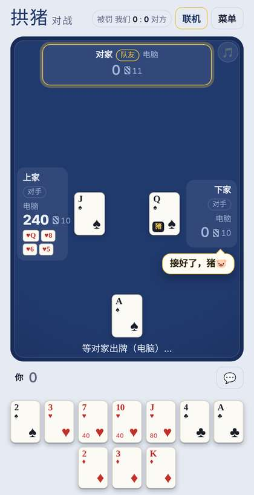

# 芒市拱猪 · Mangshi Gong Zhu

[中文](#中文) · [English](#english)

云南芒市的四人扑克「拱猪」，打开网页就能和朋友联机打，也能和电脑练手。

A four-player trick-taking card game from Mangshi, Yunnan. Play it online with friends in your browser, or against the computer.

### ▶ 开打 / Play now: **https://keyiqin9-byte.github.io/gongzhu/**

---

## 中文

### 拱猪是什么

拱猪是四个人、两两一队的扑克游戏，和外国的「红心大战」是亲戚。这个网页按云南德宏芒市的打法来。

- 四个人，坐对面的两个人一队。
- 去掉大小王，每人 13 张牌。
- 一墩一墩地打：先出牌的人定花色，其他人手里有这门就必须跟。这门里最大的那张收下这一墩，下一墩由他先出。牌从小到大是 2 3 4 5 6 7 8 9 10 J Q K A。
- 第一把由拿着 ♠7 的人先出 ♠7。以后每把由上一把输家的队友先出。
- 带分的牌都被收完，这一把就打完了。

### 哪些牌有分

| 牌 | 分 |
|---|---|
| ♥2 ♥3 ♥4 | 0 |
| ♥5 到 ♥10 | 每张 40 |
| ♥J ♥Q ♥K ♥A | 80、120、160、200 |
| ♠Q「猪」 | 400 |
| ♦J「羊」 | 400 |
| ♣10「波」 | 收到它的人，自己的分 ×8 |

### 怎么算输赢

- 分是坏东西。一把打完，分最高的人输，他的队友跟着一起输。
- 一个人把 13 张红桃都收了，叫「满贯」，他这队直接赢。红桃加上猪、羊、波全收了，叫「大满贯」，赢了还罚对方双倍。
- 两队的最高分一样，算平局。
- 罚份（我们这里的打法）：看输家那队分最高的人。3000 分以内罚 1 份，3000 分起罚 2 份，6000 分起罚 3 份，9000 分起罚 4 份，大满贯翻倍。牌不好的时候，少输就是赢。

### 打法小窍门

- 记牌：猪、羊、波出了没有，谁已经没有哪门了。
- 队友主动拿大牌吃了一墩，多半是想让你接着回这门。
- 出 2 一般是信号：这门我没有了。
- 对方在收红桃的时候，垫一张小红桃给队友，破他的满贯。
- 自己 0 分时可以替队友把波收了，0 分 ×8 还是 0。
- 大牌别攒到最后才出，免得最后一口气全吃。

### 怎么用这个网页

1. 用手机或电脑打开 https://keyiqin9-byte.github.io/gongzhu/ 。在微信里打不开的话，点右上角「···」，选「在浏览器打开」。
2. 填一个名字。
3. 点「开房间，等朋友来」，把邀请链接发到微信群，朋友点开就坐进来；也可以把 4 位房间号告诉他们。没人坐的位置由电脑补上。
4. 想自己玩，就点「和电脑打」。

打的时候：

- 每人每手有 15 秒或 30 秒，时间到了系统替你出一张。
- 实在打不下去可以投降：投降的人把剩下的分全吃下，联机时要队友同意。
- 电脑配合的时候会冒个气泡说一句，比如「回你♠」「破满贯！」。
- 点 💬 发快捷语和表情，全桌都看得到。
- 牌桌右上角的 🎵 可以开关背景音乐。
- 每把结束能看到这把的配合：谁回了谁的牌、谁破了满贯、谁替队友挡了波。

### 牌谱和隐私

打完的牌会匿名记下来，只有随机编号、出了什么牌和输赢，不记名字。这些牌谱用来改进电脑的打法。

### 给想研究的人

- 整个游戏就是一个网页文件 `index.html`，不用安装，放在 GitHub Pages 上。
- 联机借公共 MQTT 服务器（EMQX）同步房间。
- `tools/` 里是复盘牌谱、新旧电脑对打的脚本，说明见 [tools/README.md](tools/README.md)。
- 各地拱猪的打法不太一样。欢迎在 Issues 里讲讲你们那里的规矩，也欢迎提建议和报 bug。

---

## English

### What is Gong Zhu?

Gong Zhu (拱猪, "chase the pig") is a Chinese trick-taking card game for four players in two partnerships, a cousin of Hearts. This site plays it the way it is played in Mangshi (芒市), in the Dehong region of Yunnan.

- Four players; partners sit opposite each other.
- A standard 52-card deck without jokers, 13 cards each.
- Follow suit if you can. The highest card of the suit led wins the trick, and its winner leads the next one. Cards rank 2 (low) up to A (high).
- In the first hand, whoever holds the ♠7 must lead it. In later hands, the partner of the previous hand's loser leads.
- A hand ends as soon as every point card has been taken.

### Point cards

| Card | Points |
|---|---|
| ♥2 ♥3 ♥4 | 0 |
| ♥5 to ♥10 | 40 each |
| ♥J ♥Q ♥K ♥A | 80, 120, 160, 200 |
| ♠Q, the "Pig" | 400 |
| ♦J, the "Sheep" | 400 |
| ♣10, the "Bo" | multiplies its taker's points by 8 |

### Winning and losing

- Points are bad. The player with the highest score loses, and so does their partner.
- Taking all 13 hearts is a "slam" and wins outright for your team. All 13 hearts plus the Pig, the Sheep and the Bo is a "grand slam": you win and the penalty is doubled.
- If both teams' top scores are equal, the hand is a tie.
- House penalty: the losing team pays according to its top scorer. Under 3,000 points it pays 1 unit; from 3,000 it pays 2, from 6,000 3, and from 9,000 4. A grand slam doubles it. With a bad hand, losing small is a win.

### Tips

- Keep track of the cards: has the Pig, the Sheep or the Bo gone yet, and who is out of which suit?
- When your partner wins a trick on purpose with a high card, they usually want you to lead that suit back.
- Playing a 2 is usually a signal: "I'm out of this suit."
- When an opponent is collecting hearts, slip a low heart to your partner to break the slam.
- With 0 points you can take the Bo for your partner: 0 × 8 is still 0.
- Don't hoard high cards until the end, or you may be forced to take every trick at once.

### Playing on this site

1. Open https://keyiqin9-byte.github.io/gongzhu/ on a phone or a computer. Inside WeChat, tap "···" and choose "Open in browser" if the page won't load.
2. Enter a name.
3. Tap 「开房间，等朋友来」 (create a room) and share the invite link, or tell your friends the 4-digit room code. Computer players fill the empty seats.
4. Or tap 「和电脑打」 to play against the computer.

The interface is in Chinese. During play:

- Each move has a 15- or 30-second timer; if it runs out, a card is played for you.
- You can surrender. The surrendering player takes all the remaining points, and online games need your partner's agreement.
- Computer players say what they are doing in a speech bubble, such as 「回你♠」 ("back to you in spades") or 「破满贯！」 ("slam broken!").
- 💬 sends quick phrases and emoji that the whole table sees.
- 🎵 in the top-right corner of the table turns the background music on or off.
- After each hand, a summary shows the teamwork: who led back whose suit, who broke a slam, and who took the Bo for a partner.

### Game records and privacy

Finished hands are recorded anonymously: random ids, the cards played and the result, with no names. The records are used to improve the computer players.

### For developers

- The whole game is one HTML file, `index.html`. There is no build step, and GitHub Pages hosts it.
- Online rooms are synchronized through a public MQTT broker (EMQX).
- `tools/` holds scripts for replaying records and pitting computer versions against each other; see [tools/README.md](tools/README.md).
- House rules differ from town to town. Issues describing your local rules, suggestions and bug reports are all welcome.
